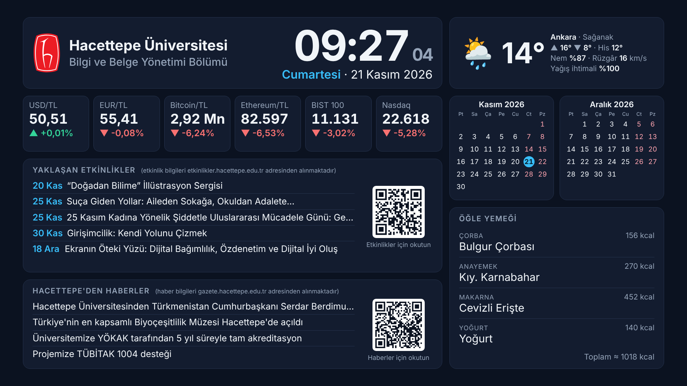

# testRaspberryPi — Bilgi Ekranı

Raspberry Pi'ye bağlı 1920x1080 TV için Python (Flask) ile çalışan bilgi panosu.



## Gösterilenler
- Hacettepe Üniversitesi arması, bölüm adı, saat ve tarih
- Hava durumu (Open-Meteo, varsayılan: Ankara)
- USD/TL, EUR/TL, Bitcoin/TL, Ethereum/TL, BIST 100, Nasdaq (hepsinde günlük % değişim; ▲ artı, ▼ eksi)
- İki aylık takvim (mevcut ve sonraki ay, yan yana kare)
- Günlük öğle yemeği listesi (beslenme.hacettepe.edu.tr)
- Hacettepe haberleri (gazete.hacettepe.edu.tr) ve haberler sayfasına karekod
- Yaklaşan etkinlikler (etkinlikler.hacettepe.edu.tr) ve etkinlikler sayfasına karekod

## Çalıştırma
```bash
python3 -m venv .venv
.venv/bin/pip install -r requirements.txt
.venv/bin/python -m bilgiekrani.app      # http://<adres>:8080
```

Ayarlar ortam değişkenleriyle yapılır: `PORT`, `BE_HOST`, `BE_CITY`, `BE_LAT`, `BE_LON`,
`BE_LUNCH_LOCATION` (1 = Beytepe, 2 = Sıhhiye).

## Raspberry Pi'de kalıcı kurulum (TV açılınca otomatik başlar)
Pi, TV'nin USB'sinden beslenir; TV açılınca Pi açılır, kapanınca elektrik kesilir. Bu senaryo için:
```bash
git clone https://github.com/orcunmadran/testRaspberryPi.git
cd testRaspberryPi
bash deploy/install.sh      # bir kez; sonra: sudo reboot
```
`install.sh` şunları yapar:
- Sunucuyu **systemd servisi** olarak kurar: Pi açılınca başlar, çökerse 5 sn sonra yeniden başlar.
- Masaüstü açılınca **Chromium'u tam ekran (kiosk)** açar (`deploy/kiosk.sh`): önce yerel sunucunun hazır olmasını bekler, tarayıcı kapanırsa yeniden açar. Her açılışta temiz profil kullanır, ani elektrik kesintisinden sonra "oturumu geri yükle" uyarısı çıkmaz.
- Ekranın kararmasını kapatır.

Önkoşul: Raspberry Pi OS (masaüstlü) ve **masaüstüne otomatik giriş** (`sudo raspi-config` → System Options → Boot / Auto Login → Desktop Autologin).

Servis günlüğü: `journalctl -u bilgiekrani -f`. Varsayılan olarak sunucu yalnızca Pi'nin kendisinden erişilebilir
(`BE_HOST=127.0.0.1`); telefondan da görmek istersen `deploy/bilgiekrani.service` içinde `0.0.0.0` yap.

### İnternet kontrolü
- Sunucu internet olmadan da açılır; saat ve takvim çalışır, veriler gelene kadar kutular boş kalır.
- Hiçbir kaynağa ulaşılamıyorsa ekranda **"İnternet bağlantısı yok"** kutusu çıkar. Bir ya da birkaç kaynak sorunluysa köşede küçük uyarı görünür; son başarılı veri gösterilmeye devam eder.
- Sorun varken sayfa 10 sn'de bir, yoksa dakikada bir yeniler. Başarısız kaynak 30 sn sonra yeniden denenir; WiFi geç bağlansa da kendiliğinden toparlanır.
- Pi'de gerçek saat (RTC) yoktur; saat WiFi bağlanıp NTP eşitleyene kadar yanlış olabilir. Eşitlenince tarih/takvim kendiliğinden düzelir.

### Ani elektrik kesintisi
Her akşam elektrik aniden kesildiği için SD kart zamanla bozulabilir. Önlem olarak kurulumdan sonra
`sudo raspi-config` → Performance Options → **Overlay File System** ile sistemi salt-okunur yapmanı öneririm
(değişiklik yapmak istediğinde önce kapatman gerekir).

## Geliştirme
```bash
.venv/bin/pip install -r requirements-dev.txt
.venv/bin/python -m pytest
.venv/bin/python scripts/screenshot.py docs/ekran.png   # 1920x1080 görüntü
```
Playwright'ın tarayıcısı yoksa `CHROMIUM_PATH=/yol/chromium` verilebilir.

## Notlar
- Veri kaynakları önbelleğe alınır; bir kaynak erişilemezse son başarılı veri gösterilir ve köşede uyarı çıkar.
- USD/EUR günlük değişimi Yahoo Finance'ten gelir; erişilemezse open.er-api.com yedeği kullanılır (yüzde gösterilmez).
- Karekodları yeniden üretmek için: `python scripts/make_qr.py` (adresler o dosyada).
- Logo, www.hacettepe.edu.tr'deki resmî arma SVG'sinden kırpılmıştır (`bilgiekrani/static/logo.svg`).
- Siteler yapısını değiştirirse `bilgiekrani/providers.py` içindeki `parse_*` fonksiyonları ve `tests/fixtures` güncellenmelidir.
